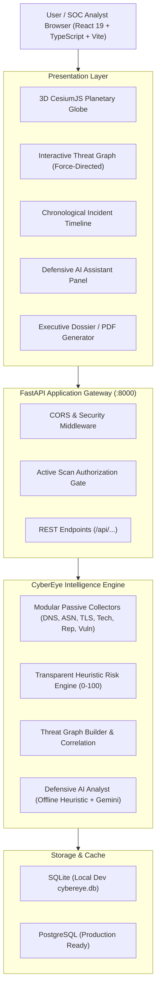
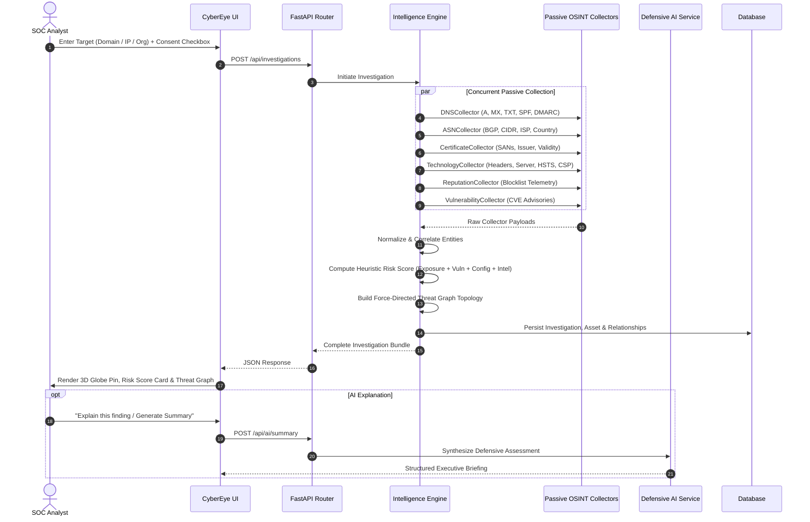

# CYBEREYE System Architecture

**CYBEREYE** is an AI-powered cyber-intelligence and OSINT visualization platform designed to reduce the time required to collect, understand, correlate, and visualize publicly available cybersecurity intelligence.

---

## 1. High-Level Architectural Flow

---

## 2. Intelligence Processing Lifecycle

---

## 3. Subsystem Breakdown

### 3.1 3D Planetary Globe (CesiumJS)
- **Engine**: CesiumJS WGS84 ellipsoid renderer.
- **Layers**: Multi-layer toggling for Cyber Events, Infrastructure (Submarine Cables, Data Centers), Earthquakes (USGS API), Weather Events, Maritime Transport, and Threat Advisories.
- **Dynamic Telemetry**: Point markers color-coded by severity (Critical, High, Medium, Low) and animated geodesic attack trajectory arcs.
- **Resilience**: Safe 2D canvas fallback if WebGL acceleration is constrained.

### 3.2 Threat Graph (Force-Directed Node-Link)
- **Nodes**: `Domain`, `IP`, `ASN`, `Organization`, `CVE`, `Technology`, `Event`.
- **Edges**: `resolves_to`, `belongs_to`, `associated_with`, `affected_by`, `located_in`, `runs_service`.
- **Simulation**: Real-time repulsion physics, spring tension, drag-and-drop, zoom/pan, and node inspector flyouts.

### 3.3 Transparent Risk Scoring Engine
$$\text{Risk Score} = \text{Asset Exposure} + \text{Vuln Severity} + \text{Security Config} + \text{Intelligence Indicators}$$
- **0–29 LOW**: Minimal public exposure, robust security headers.
- **30–59 MEDIUM**: Standard perimeter footprint, minor advisory matches.
- **60–79 HIGH**: Exposed server banners, unpatched high-severity CVEs, missing HSTS.
- **80–100 CRITICAL**: Acute vulnerability exposure or active malicious reputation flags.
- **Auditability**: Every score returns an explicit points breakdown table explaining *why* the score was assigned.

### 3.4 Defensive AI Analyst
- Enforces strict defensive cybersecurity safety bounds.
- Rejects requests seeking exploit payloads, credential theft, or unauthorized access instructions.
- Provides actionable remediation guidance, CVE plain-English summaries, and investigation summaries.
- Functions 100% offline via built-in heuristic analysis when no API key is set.
