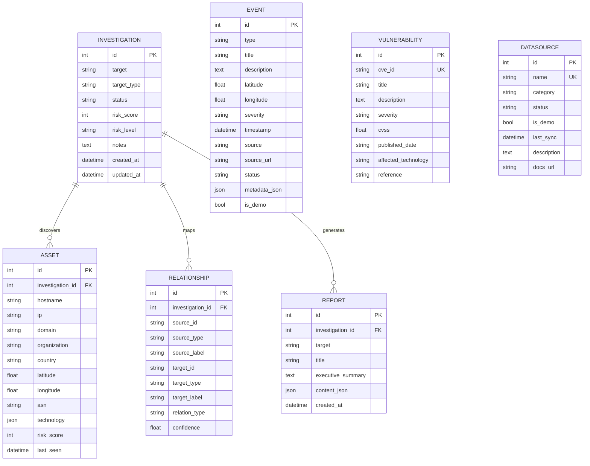

# CYBEREYE Database Schema & Models

CyberEye supports both **SQLite** (out-of-the-box local development fallback at `cybereye.db`) and **PostgreSQL** (production deployment via standard connection strings).

---

## 1. Entity-Relationship Diagram (ERD)

---

## 2. Table Specifications

### `investigations`
| Column | Type | Constraints | Description |
|---|---|---|---|
| `id` | Integer | Primary Key, Auto Increment | Unique investigation ID |
| `target` | String(255) | Indexed, Not Null | Evaluated domain, IP, or organization |
| `target_type` | String(50) | Not Null | `domain`, `ip`, or `organization` |
| `status` | String(50) | Default: `completed` | Pipeline execution state |
| `risk_score` | Integer | Default: 0 | Normalized score (0-100) |
| `risk_level` | String(20) | Default: `LOW` | `LOW`, `MEDIUM`, `HIGH`, `CRITICAL` |
| `notes` | Text | Nullable | Context notes or scan summary |
| `created_at` | DateTime | UTC Timestamp | Creation time |

### `events`
| Column | Type | Description |
|---|---|---|
| `id` | Integer PK | Event primary key |
| `type` | String(100) | `Cybersecurity`, `Infrastructure`, `Natural event`, `Vulnerability` |
| `title` | String(255) | Human-readable incident title |
| `description` | Text | Technical narrative |
| `latitude` | Float | Geospatial latitude coordinate (-90 to 90) |
| `longitude` | Float | Geospatial longitude coordinate (-180 to 180) |
| `severity` | String(50) | `CRITICAL`, `HIGH`, `MEDIUM`, `LOW` |
| `source` | String(100) | Telemetry provider (e.g. CISA, BGPmon, USGS) |
| `metadata_json` | JSON | Layer attributes (attack origin, volume, cable names) |
